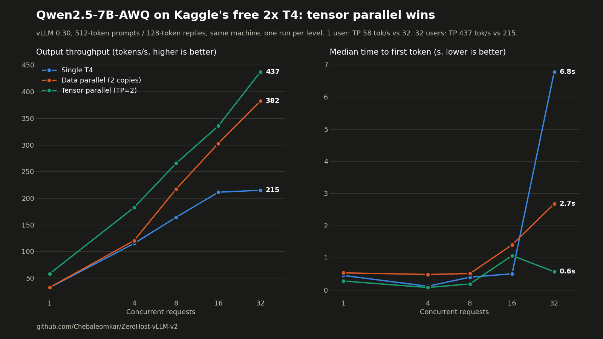

# ZeroHost vLLM v2: single GPU vs data parallel vs tensor parallel

**Kaggle gives you two free T4 GPUs. [ZeroHost v1](https://github.com/Chebaleomkar/ZeroHost-vLLM) used one of them.** v2 uses both, with a load-balancing proxy, and runs a head-to-head benchmark of the three ways to serve a model on two GPUs, in one Kaggle session, on the same machine. It then serves the winner as an authenticated, OpenAI-compatible HTTPS API.



**Result: tensor parallel won, even over plain PCIe.** I predicted the opposite.

| | Single T4 | Data parallel (2 copies) | **Tensor parallel (TP=2)** |
|---|---|---|---|
| Speed for 1 user | 32 tok/s | 32 tok/s | **58 tok/s (1.8x)** |
| Time to first token, 1 user | 449 ms | 530 ms | **276 ms** |
| Output throughput, 32 concurrent | 215 tok/s | 382 tok/s (1.8x) | **437 tok/s (2.0x)** |
| Median time to first token, 32 concurrent | 6.8 s | 2.7 s | **0.57 s** |
| Requests/s, 32 concurrent | 1.68 | 2.99 | **3.41** |
| GPU utilization under load (GPU 0 / GPU 1) | 100% / idle | 85% / 66% | **100% / 100%** |

Model: Qwen2.5-7B-Instruct-AWQ (4-bit), vLLM 0.30.0, 512-token prompts and 128-token replies. Full table: [`data/comparison.md`](data/comparison.md).

---

## The three modes

```
single : [GPU 0: whole model]                       16 request slots   (the v1 baseline)
dp     : [GPU 0: whole model] [GPU 1: whole model]  2 x 16 slots, the proxy load-balances
tp     : [GPU 0: half of every layer | GPU 1: half] 32 slots, GPUs sync on every layer
```

- **Data parallel (DP):** two independent copies of the model, one per GPU. More capacity, but every request still runs on one GPU at one GPU's speed.
- **Tensor parallel (TP):** one copy of the model split across both GPUs. Every layer's math is divided in two, and the GPUs exchange partial results (all-reduce) after each layer.

To make it fair, TP gets 32 request slots, the same total as DP's 2 x 16.

## Why tensor parallel won

**I expected data parallel to win.** The diagnostics showed the two T4s are connected through the CPU's PCIe host bridge (`nvidia-smi topo -m` says `PHB`), with no NVLink. TP has to sync the GPUs after every layer over that slow link, so I assumed the communication cost would sink it.

It didn't, because of what limits a T4. When an LLM generates text, every token requires reading **all of the model's weights** from GPU memory. The math is small; the memory traffic is the bottleneck. A T4 reads about 320 GB/s.

- **TP** splits the weights, so each GPU reads half. Two GPUs reading in parallel gives roughly **double the memory bandwidth per token**. That's why one user went from 32 to 58 tok/s. The all-reduce traffic per token is small by comparison, so the PCIe link didn't matter much.
- **DP** gives each request one GPU, so a single user gets exactly single-GPU speed (32 tok/s). Its gains only come from running more requests in parallel.

**Data parallel also looked CPU-starved.** Kaggle's machine has 4 vCPUs. DP runs two full vLLM processes (each an API server plus an engine core) on them, and its GPUs never reached full use (85% and 66%, against TP's 100% and 100%). DP also had a ~500 ms floor on time to first token at light load, where the others had ~100 ms. So "TP beats DP" is a result for **this machine**; on a host with more CPU cores the gap could be smaller.

**Where data parallel did win:** tail latency at light load. With 4 concurrent requests, the first burst of prompts splits across two engines, so DP's worst first-token wait was ~1 s against 3.6 s (single) and 4.5 s (TP). After that first burst, all three modes settled to low steady-state latency.

---

## How it works

```
 any OpenAI client
        │  HTTPS + Bearer key
        ▼
 ngrok static domain
        │
 ┌──────┴─────────────────── Kaggle notebook, 2x T4 ─────────────────────┐
 │ load-balancing proxy :8000                                            │
 │   auth · least-outstanding-requests routing · failover · traces       │
 │        │                         │                                    │
 │   vLLM :8001 (GPU 0)       vLLM :8002 (GPU 1)      ← dp mode          │
 │   vLLM :8001 (GPU 0 + GPU 1, TP=2)                 ← tp mode          │
 │                                                                       │
 │ mode runner: start mode → wait healthy → benchmark → stop → next      │
 │ metrics sampler: both GPUs + every engine's Prometheus, every 15 s    │
 └───────────────────────────────────────────────────────────────────────┘
```

One script, [`zerohost_v2.py`](zerohost_v2.py), does everything in a single Kaggle session:

1. **Diagnostics:** `nvidia-smi`, GPU topology and shared memory, logged before anything starts.
2. **Load-balancing proxy:** each request goes to the engine with the **fewest requests in progress**, with round-robin breaking ties. If an engine refuses a connection, the proxy marks it down for 10 s and retries on the other one. Every trace records the mode and the engine that served it. In the DP benchmark the proxy split requests exactly **200 / 200** across the GPUs, with 0 errors across 1,200 requests.
3. **Mode runner:** runs `single`, `dp` and `tp` back to back. Each mode is started, health-checked on every engine, benchmarked, then stopped.
4. **Benchmark:** `vllm bench serve` at 1, 4, 8, 16 and 32 concurrent requests, run inside Kaggle **through the proxy**, so every mode pays the same proxy cost and DP actually exercises the balancer.
5. **Comparison:** writes `comparison.md` and `comparison.json` and prints the table to the log.
6. **Serving:** keeps the winning mode (`SERVE_MODE = "tp"`) running, opens the ngrok tunnel and supervises it, restarting engines and the tunnel if they die, until a clean exit at 11h45m.

---

## Quick start

Requirements are the same as v1: a phone-verified Kaggle account, a free ngrok account (authtoken + free static domain) and Python 3.10+.

```bash
git clone https://github.com/Chebaleomkar/ZeroHost-vLLM-v2.git
cd ZeroHost-vLLM-v2
pip install kaggle
python -m kaggle auth login
python setup.py          # asks for your ngrok token + domain, generates an API key, can push the kernel
```

`setup.py` stores your secrets in a **private** Kaggle dataset `<you>/zerohost-secrets` (the same one v1 uses, so v1 users can just re-run it), writes `kernel-metadata.json` for your account, and optionally pushes the notebook.

Then follow the run:
```bash
python -m kaggle kernels logs -f <your-kaggle-username>/zerohost-vllm-v2
```

Timeline: ~5 min install, ~8-10 min per mode, so the comparison table prints after ~35-40 min, followed by `PUBLIC_URL https://<your-domain>/v1`. Then call it like any OpenAI endpoint:

```bash
curl https://<your-domain>/v1/chat/completions \
  -H "Authorization: Bearer <your API key>" \
  -H "ngrok-skip-browser-warning: 1" \
  -H "Content-Type: application/json" \
  -d '{"model":"qwen2.5-7b-instruct","messages":[{"role":"user","content":"Hello!"}]}'
```

**Stop it** in Kaggle under **Active Events → Stop session** when you're done. It otherwise serves until the 12h limit and uses your 30 h/week GPU quota. Download traces, metrics and benchmark files while it runs with `GET /admin/files` and `GET /admin/files/<name>` (same API key).

### Configuration (top of `zerohost_v2.py`)

| Setting | Default | Meaning |
|---|---|---|
| `MODES` | `["single", "dp", "tp"]` | Modes to benchmark, in order. The last one keeps running if it is `SERVE_MODE` |
| `SERVE_MODE` | `"tp"` | Mode served publicly after the comparison |
| `ENGINES` | see file | Per mode: GPUs, port, tensor-parallel size and request slots of each vLLM process |
| `BENCH_CONCURRENCY` | `[1, 4, 8, 16, 32]` | Concurrency levels for `vllm bench serve` |
| `BENCH_INPUT`, `BENCH_OUTPUT` | `512`, `128` | Prompt and reply lengths in tokens |

To skip the comparison and only serve, set `MODES = ["tp"]`.

---

## Methodology and caveats

- **Same machine, same session, same cached weights.** All three modes ran back to back on one Kaggle 2x T4 machine (PCIe `PHB` topology, 4 vCPUs, 14 GB `/dev/shm`).
- **Measured inside Kaggle, through the proxy.** No ngrok and no internet in the path, so these numbers are the server's capacity, not what a remote user sees. v1 measured ~0.3 s of extra time to first token through ngrok.
- **One run per level.** Each level had 32 to 192 requests. Low-concurrency percentiles rest on very few requests, and some points are noisy (TP's median time to first token reads 1.07 s at 16 concurrent and 0.57 s at 32).
- **p95 at 4 concurrent is a first-burst artifact.** The 3.6 s (single) and 4.5 s (TP) p95 values came only from the first 4 requests arriving together at an idle engine. After that burst, p95 was ~100 ms. At 8 concurrent and up, the higher numbers are real queuing.
- **Short prompts only.** 512-token prompts flatter every mode. Coding agents send 5-10K-token prompts, where prompt processing dominates. A long-context sweep is next.
- **Served-mode order changed after the run.** The benchmark ran in the order `single, tp, dp` and served DP. Since TP won, the committed default is `single, dp, tp` serving TP. The mode switch itself is proven (GPU memory dropped to 0 MiB within 2 s at every switch), but this exact order hasn't been run end to end yet.

---

## Lessons

1. **Measure before you assume.** PCIe-only GPUs "should" make tensor parallel slow. On a memory-bound T4, the bandwidth gain beat the sync cost.
2. **Kill the process group, not the process.** vLLM's API server spawns an engine core child that holds the GPU memory. `proc.terminate()` leaves it alive and the next mode crashes out of memory. `os.killpg()` plus waiting for VRAM to read ~0 MiB fixed it.
3. **Proxies leak IPs unless you stop them.** In v1, vLLM's access log recorded every client's public IP, because the forwarded-for headers passed straight through. v2's proxy strips `X-Forwarded-For`, `X-Real-IP` and `Forwarded` before they reach vLLM.
4. **Kaggle's 4 vCPUs are a real limit.** Two vLLM processes were enough to leave the GPUs under-used.
5. **Tensor parallel on Kaggle T4s just works** with vLLM 0.30: no NCCL flags, ~2.7 min cold start.

---

## Repo layout

| Path | Contents |
|---|---|
| `zerohost_v2.py` | The Kaggle script: mode runner, load-balancing proxy, benchmarks, metrics, tunnel, supervisor |
| `setup.py` | One-time setup for your Kaggle account (secrets dataset, kernel metadata, push) |
| `kernel-metadata.template.json` | Kaggle kernel config (T4 machine, GPU and internet on) |
| `test_proxy.py` | Local test of the balancer with two fake engines: auth, least-outstanding routing, failover, stripped IP headers, 503 when no engine is up (`python test_proxy.py`) |
| `bench.sh` | External GuideLLM benchmark through your public URL (Linux, macOS or WSL), see v1 |
| `assets/v2_benchmark.png` | The chart above |
| `data/comparison.md`, `comparison.json` | The full comparison table |
| `data/bench/` | Raw `vllm bench serve` results, one file per mode and concurrency |
| `data/traces_metadata.jsonl` | 1,201 request traces with mode and engine. Timings and token counts only; prompt text, outputs and client IPs removed |
| `data/metrics.jsonl` | Every 15 s: both GPUs (utilization, memory, temperature, power) and every engine's vLLM metrics |
| `data/logs/` | vLLM log for each mode and engine (internal IPs masked) |
| `data/run_log.txt` | The session log: diagnostics, GPU topology and every benchmark line |

## Roadmap

- Long-context sweep (2K to 16K-token prompts), which is closer to what a coding agent sends.
- Data parallel on a host with more CPU cores, to test the CPU-starvation explanation.
- Capture tool calls and true time to first token in traces.
- Quantization shootout: FP16 vs AWQ vs GPTQ vs GGUF on the same model.

Built on [ZeroHost v1](https://github.com/Chebaleomkar/ZeroHost-vLLM), which covers the single-GPU setup, tracing and the first round of benchmarks.
